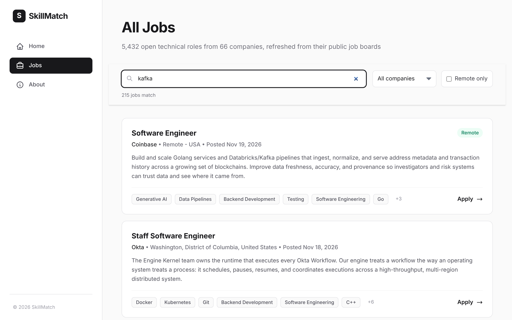
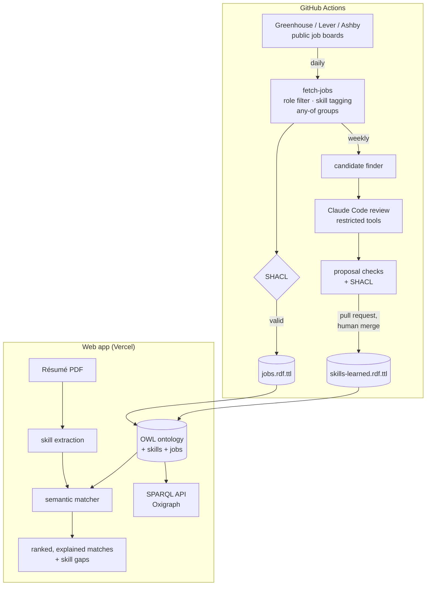

# SkillMatch

**Skills-first job matching on a knowledge graph that grows itself.**
Upload a résumé and get real, current tech job openings ranked by how well your skills cover each one, with the reasoning for every match.

<!-- Replace with your Vercel URL after deploying (see docs/DEPLOY.md) -->
**Live demo:** _deploying soon_ · [How to deploy](docs/DEPLOY.md)


## Why

Keyword search fails job seekers in two ways: it misses roles that describe the same skill in different words, and it floods them with roles that share one buzzword. SkillMatch compares **what you can do** with **what each job needs**, using a graph of how skills relate:

- your **PostgreSQL** satisfies a job's **SQL** requirement, because PostgreSQL is a kind of SQL;
- **PyTorch** gets partial credit for **TensorFlow**, a close substitute;
- **"AWS, GCP, or Azure"** is one requirement you meet with any of the three.

Every result shows which requirements you meet, how, and what's missing, plus the skills that would open the most doors across your top matches.

## Highlights

| | |
|---|---|
| **Real data** | ~5,400 open technical roles from 66 companies, read daily from the public Greenhouse, Lever and Ashby job-board APIs |
| **A graph that grows** | 126 hand-curated skills grew to **223** through an AI-proposed, rule-checked, human-reviewed pipeline, and keeps growing weekly |
| **Semantic web, for real** | RDF/OWL ontology, SHACL validation (including SHACL-SPARQL constraints), SPARQL 1.1 via Oxigraph, provenance on every learned skill |
| **Explainable** | per-requirement checklists, "any of" requirements, skill-gap advice; no black-box score |
| **Runs anywhere** | no database or API keys; in-memory graph by default, Neo4j optional; free hosting on Vercel |
| **Tested and automated** | 69 tests, CI, daily data refresh and weekly graph review in GitHub Actions |

## Screenshots

| Results with requirement checklist | Skills found and gaps |
|---|---|
|  |  |
| **Home with sample résumés** | **All jobs, searchable** |
|  |  |

## Architecture



## Engineering decisions

- **Validate everywhere data changes.** SHACL runs when jobs are written, when skills are added, and before every build. Turning it on exposed 37 dangling skill references in the original data, and it now blocks bad AI proposals.
- **AI proposes, rules check, people approve.** Claude only writes a JSON proposal in a sandboxed step; deterministic checks (name collisions, relation targets, case-sensitive ambiguous words like "Go") and SHACL decide whether it can be applied, and a pull request lets a person review it.
- **Real data drove most fixes.** Running on thousands of real postings surfaced problems no sample data would: "AI company" boilerplate tagging every job, "A/B testing" also counting as "Testing", "Go" matching "go-to-market", the "r" in "résumé" matching the R language, degree lines ("MS in Operations Research") read as skills, and the same role posted in five cities. Each has a fix and a test.
- **Honest scores, smoothed ranking.** The displayed score is plain coverage of requirements; ranking adds a small prior so a posting with one detected skill doesn't outrank one where 8 of 9 requirements match.
- **Cheap to run.** The graph lives in memory (N3.js for lookups, Oxigraph only when a SPARQL query needs it). Moving validation to build time cut cold start from ~7.5 s to ~2.6 s and memory from ~930 MB to ~560 MB.

## Results

| | |
|---|---|
| Job postings | ~5,400 technical roles, 66 companies, refreshed daily |
| Skills in the graph | 126 → 223 after the first review (97 added, 107 candidate terms rejected with reasons) |
| Postings with recognised skills | 95.3% → 97.2% |
| Skills recognised in a typical data-engineer résumé | 4 → 11 after the first review |
| Postings with "any of" requirements | 37% |
| Performance | ranks all postings for a résumé in ~1 s; cold start ~2.6 s |

## How matching works

1. **Extract**: the résumé text is scanned for every skill name and alias in the ontology, using Unicode-aware token boundaries (so "R" isn't found inside "for" or "résumé", and "Java" isn't found inside "JavaScript"). Ambiguous names like "Go" match only with exact capitalisation.
2. **Relate**: for each requirement, the candidate's strongest related skill is found in the graph:

   | Relation | Example | Weight |
   |---|---|---|
   | exact | Python → Python | 1.0 |
   | equivalent | `owl:SymmetricProperty` | 1.0 |
   | narrower (you're more specific) | PostgreSQL → SQL | 0.85 |
   | two-level narrower | Django → Python → Programming | 0.7 |
   | similar | PyTorch ≈ TensorFlow | 0.6 |
   | broader (you're more general) | SQL → PostgreSQL | 0.5 |

3. **Score**: the weights are summed and divided by the number of requirements, so missing requirements lower the score. "Any of" requirements ("AWS, GCP, or Azure", "e.g. Python, Java") are one requirement met by any member (`sm:requiresOneOf` → `sm:SkillGroup`).
4. **Rank**: by `weighted / (requirements + 3)`. The same role posted in several cities is shown once, with its other locations.
5. **Advise**: the requirements missing most often across your top matches are shown as "skills that would open the most doors".

Uploaded résumés are parsed in memory and never stored.

## Job data

Jobs come from the **public job-board APIs** that companies publish their openings through (Greenhouse, Lever and Ashby). These are free and need no key or scraping.

```bash
npm run fetch-jobs              # refresh all companies
npm run fetch-jobs -- stripe    # refresh only some companies
```

The fetcher (`scripts/fetch-jobs.ts`):

1. downloads every posting for each company in `data/companies.json`
2. keeps technical roles (engineering, data, ML, research) and drops sales, recruiting, legal and similar
3. tags ontology skills in each description: skills under a "nice to have" heading become `sm:prefersSkill`, the rest `sm:requiresSkill`; benefits and EEO sections are ignored, and so are broad categories like "Artificial Intelligence" that appear in every posting's boilerplate
4. SHACL-validates the result, drops any posting that fails, and writes `ontology/jobs.rdf.ttl`

Postings that are no longer on a board disappear on the next run. If a board can't be reached, that company's previous postings are kept. A per-company summary is written to `data/jobs-summary.json`.

## Growing the knowledge graph

The skill graph isn't fixed. New skills are proposed by AI, checked by rules, and kept in plain files you can review:

```
job postings ──► 1. find candidates ──► 2. review (Claude) ──► 3. validate + apply ──► re-tagged jobs
                  (script, free)         (JSON proposal)        (checks + SHACL)
```

1. **Find candidates**: `npm run graph:candidates` scans every saved posting for terms listed alongside known skills ("Python, **Airflow**, or SQL") that the graph doesn't know. It counts how many postings and companies use each one, skips terms rejected before, and writes `data/skill-candidates.json`.
2. **Review**: Claude Code follows [`prompts/review-skill-candidates.md`](prompts/review-skill-candidates.md). It accepts real skills, picks a name, aliases and relations to existing skills, adds spellings of existing skills as aliases, and rejects noise (company names, degrees, verbs) with a reason. The output is a dated batch in `data/skill-proposals/`. Run it in Claude Code, interactively or with:
   ```bash
   claude -p "Follow prompts/review-skill-candidates.md"
   ```
3. **Validate and apply**: `npm run graph:apply` checks every batch: ids, name and alias collisions across the whole graph, relation targets, at least one parent skill, and ordinary words like "Go" must be case-sensitive. It then writes `ontology/skills-learned.rdf.ttl` with provenance (`sm:addedBy`, `sm:addedOn`, `sm:evidencePostings`), runs SHACL on the whole ontology, and re-tags all jobs offline. If any check fails, nothing is written. `npm run graph:apply -- --check` validates without writing.

First review (2026-11-19): **97 skills added** (Go, Java, C++, Terraform, Kafka, Airflow, Snowflake, Redis…), 1 alias added, 107 terms rejected. The graph went from 126 to 223 skills; the share of technical postings with recognised skills went from 95.3% to 97.2%; and a typical data-engineer résumé now has 11 skills recognised instead of 4.

```bash
# which skills were learned, and how much evidence each had
curl -s -X POST localhost:3000/api/sparql -H 'content-type: application/json' \
  -d '{"sparql":"SELECT ?name ?n WHERE { ?s sm:addedBy ?by ; sm:skillName ?name ; sm:evidencePostings ?n } ORDER BY DESC(?n)"}'
```

## Automation

Three GitHub Actions workflows keep the data current:

| Workflow | When | What it does |
|---|---|---|
| **Refresh jobs** (`refresh-jobs.yml`) | daily, and when skill files change on `master` | fetches postings, tags skills, SHACL-validates and commits `ontology/jobs.rdf.ttl`. No AI. |
| **Grow skill graph** (`grow-graph.yml`) | weekly (Mondays), or on demand | finds candidates, has Claude review them, validates and applies them, runs the tests and **opens a pull request**. Nothing changes until you merge it. |
| **CI** (`ci.yml`) | every push to `master` and every PR | lint, type-check, tests, build |

Safety: the refresh doesn't write if more than 25% of job boards fail or the job count drops below 60% of the previous run. A review batch that fails any check or SHACL makes the run fail without opening a PR. In the review, Claude can only read the repo, write in `data/skill-proposals/`, and run the validator.

### One-time setup

1. **Let workflows open PRs**: *Settings → Actions → General → Workflow permissions*: tick "Allow GitHub Actions to create and approve pull requests". (If `master` is protected, also allow GitHub Actions to push the daily data commit.)
2. **Claude for the weekly review** (uses your Claude Pro/Max plan, no API billing). On your own computer, with Claude Code installed:
   ```bash
   claude setup-token
   ```
   Copy the printed token (valid for a year) and add it as a repository secret named `CLAUDE_CODE_OAUTH_TOKEN` (*Settings → Secrets and variables → Actions*). Without it the review is skipped and no PR is opened.
3. Scheduled workflows only run from the default branch, so they start once this code is on `master`. To try them right away, use **Run workflow** in the Actions tab.

**To add a company**, add one line to `data/companies.json` with its board (`greenhouse`, `lever` or `ashby`) and its slug, which is the company id in the board URL (for example `boards.greenhouse.io/`**`stripe`**).

## Knowledge graph

| File | Contents |
|---|---|
| `ontology/skillmatch.owl.ttl` | OWL classes and properties (`broaderSkill` is transitive, `narrowerSkill` is its inverse, `equivalentSkill` is symmetric) |
| `ontology/skills.rdf.ttl` | about 125 hand-curated skills with aliases and relations |
| `ontology/skills-learned.rdf.ttl` | skills added through the review pipeline, with provenance (generated) |
| `ontology/jobs.rdf.ttl` | real job postings (generated by `npm run fetch-jobs`) |
| `ontology/sample-data.rdf.ttl` | 10 hand-written jobs, used by tests and when `jobs.rdf.ttl` is absent |
| `ontology/skillmatch.shacl.ttl` | SHACL shapes, including SHACL-SPARQL rules (for example, a skill can't be similar to itself) |

All data is **SHACL-validated** whenever it is written (job refresh, skill review), before every build (`npm run validate` runs as `prebuild`, so an invalid graph can't be deployed), and on load in development and tests. Core shapes are checked with `rdf-validate-shacl`, and `sh:sparql` constraints are executed with Oxigraph.

## Storage backends

| Backend | When | Notes |
|---|---|---|
| **In-memory** (default) | `NEO4J_URI` not set | N3.js for lookups and [Oxigraph](https://github.com/oxigraph/oxigraph) (WASM) for real SPARQL 1.1. No services needed. |
| **Neo4j + neosemantics** | `NEO4J_URI` set | Loads the same Turtle files into Neo4j via n10s. |

## Quick start

```bash
npm install
npm run dev
```

Open http://localhost:3000 and upload a PDF résumé, or click one of the sample résumés.

To use Neo4j instead, copy `.env.local.example` to `.env.local` and fill in `NEO4J_URI`, `NEO4J_USER` and `NEO4J_PASSWORD`. The database needs the APOC and n10s plugins.

## API

| Endpoint | Description |
|---|---|
| `POST /api/match` | multipart `file` (PDF, ≤ 5 MB) → extracted skills, up to 50 ranked matches with per-requirement explanations, and skill gaps |
| `GET /api/jobs` | paged postings, newest first: `?q=python&company=Stripe&remote=1&page=1&pageSize=20` |
| `GET /api/sparql?type=…` | named queries: `skills`, `jobs`, `related-skills&skill=python`, `jobs-by-skill&skill=sql`, `skill-hierarchy`, `match&skills=python,sql`, `stats` |
| `POST /api/sparql` | `{"sparql": "SELECT …"}` runs a read-only SPARQL query (prefixes `sm:`, `skill:`, `job:`, `org:` are predefined) |

```bash
curl -s -X POST localhost:3000/api/sparql -H 'content-type: application/json' \
  -d '{"sparql":"SELECT ?name WHERE { ?s sm:broaderSkill skill:sql ; sm:skillName ?name }"}'
```

## Development

```bash
npm test           # unit + graph tests (Vitest)
npm run typecheck
npm run lint
npm run validate   # SHACL-check the graph (also runs before every build)
npm run build
```

CI runs lint, type-check, tests and build on every push and pull request (`.github/workflows/ci.yml`).

## Project layout

```
app/                 Next.js App Router: pages and API routes
lib/jobs/            job-board adapters, role filter, skill tagging, RDF output
lib/rdf/
  graph-store.ts     backend interface; picks in-memory or Neo4j
  store.ts           in-memory store (N3 + Oxigraph)
  neo4j-store.ts     Neo4j + n10s store
  shacl.ts           SHACL + SHACL-SPARQL validation
  semantic-matcher.ts  skill extraction and scoring
  sparql.ts          named SPARQL queries
ontology/            OWL, SHACL, skills, jobs and sample data (Turtle)
data/companies.json  companies whose job boards are read
scripts/fetch-jobs.ts  refreshes ontology/jobs.rdf.ttl (--offline re-tags saved postings)
scripts/find-skill-candidates.ts, apply-skill-proposals.ts   graph growth
lib/graph/           candidate finder and proposal validation
prompts/             review instructions for Claude
data/skill-proposals/  reviewed batches (the graph's change history)
tests/               Vitest suites and fixtures
```

## Stack

Next.js 14, React 18, TypeScript, Tailwind CSS · N3.js, Oxigraph, rdf-validate-shacl · Neo4j driver (optional) · pdf-parse · Vitest

## Background

SkillMatch started as a solo final project for Info 290 at the UC Berkeley School of Information (submitted as "SkillSync"); the original write-up is in [`docs/course-submission.md`](docs/course-submission.md). Since then it has gone from 10 hand-written jobs and a Neo4j-only prototype to a deployed app with live data, a self-growing graph and automated, reviewed updates.

## License

[MIT](LICENSE)
