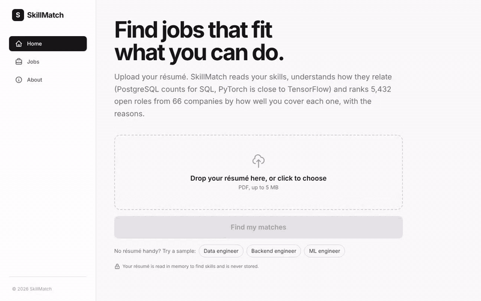
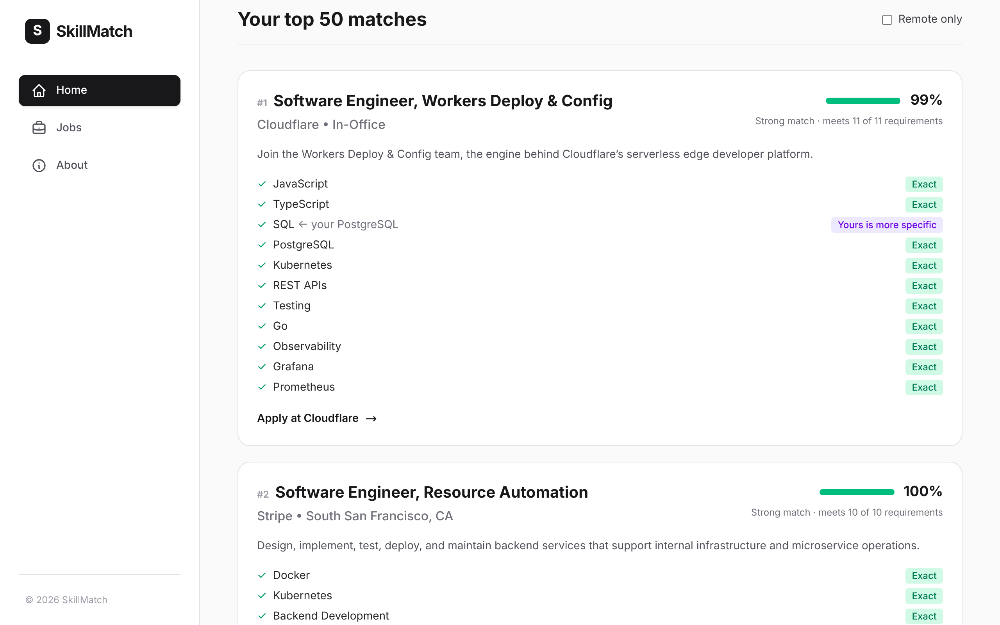
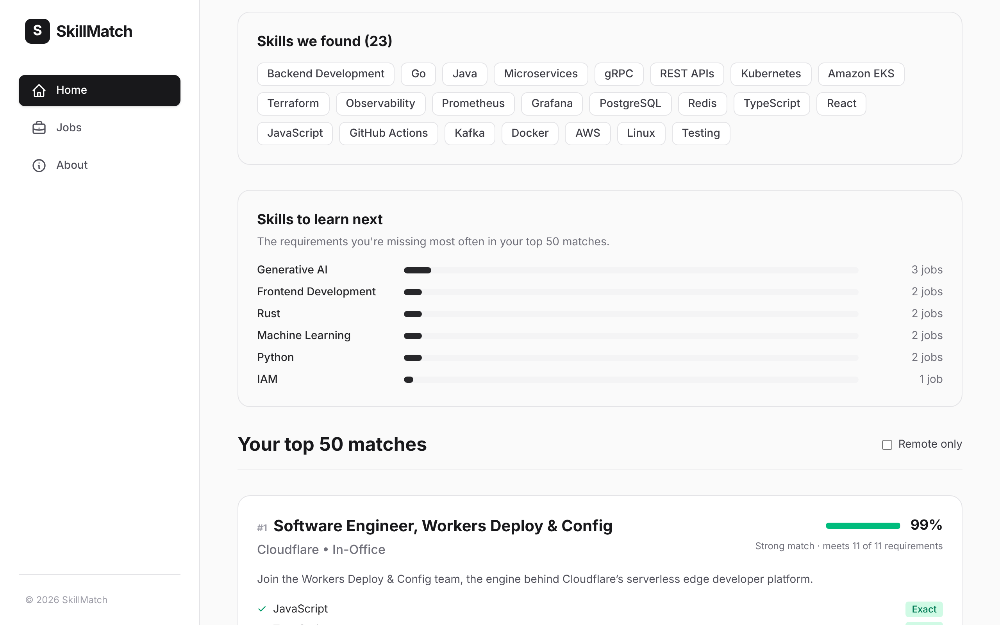
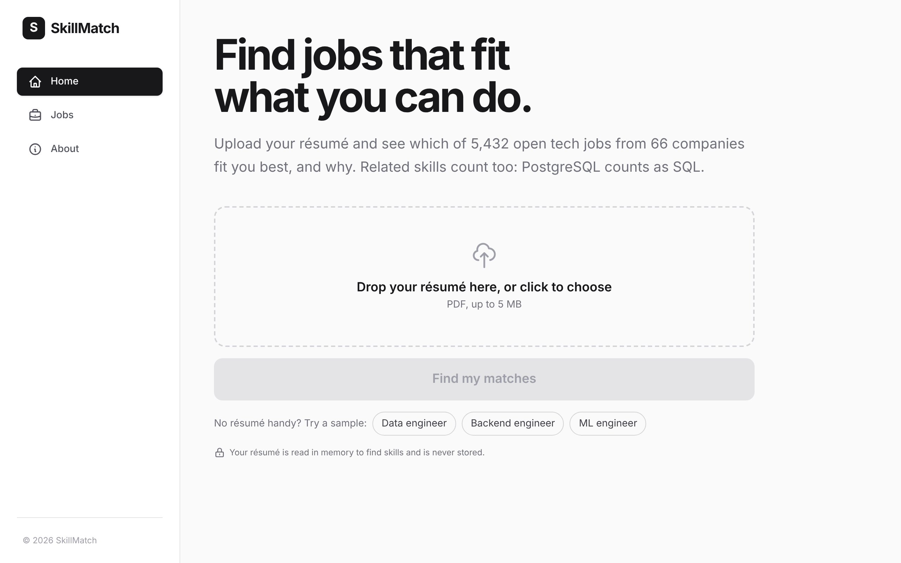
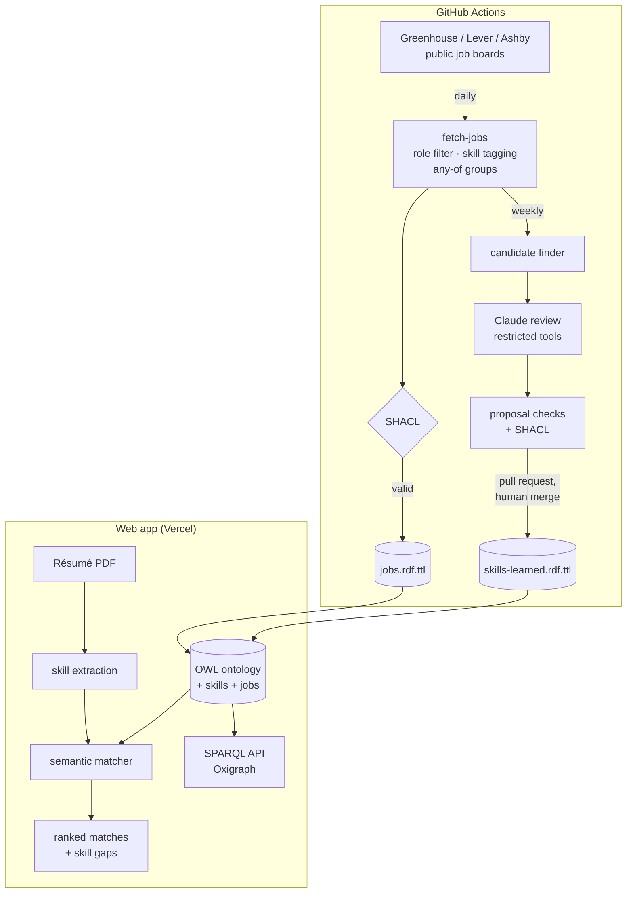

# SkillMatch

SkillMatch helps you find tech jobs that fit what you can actually do.

You upload your résumé. SkillMatch picks out your skills, compares them with about 5,400 real job openings from 66 tech companies, and shows you the jobs that fit you best. For every job it tells you which requirements you meet, which ones you're missing, and which skills would help you most.

**Live demo:** _coming soon_



## Why I built it

Most job search tools look for exact words. If a job asks for "SQL" and your résumé says "PostgreSQL", they miss the match, even though PostgreSQL *is* SQL. And they show you jobs that share one buzzword with your résumé but don't really fit.

SkillMatch knows how skills relate to each other:

- **PostgreSQL** counts as **SQL**, because it's a kind of SQL.
- **PyTorch** gets partial credit for **TensorFlow**, because they're used for the same work.
- **"AWS, GCP, or Azure"** means you need *one* of them, not all three.

## What you can do with it

- **Upload your résumé** (PDF) and get your best-matching jobs, each with a simple checklist of what you have and what's missing.
- **See which skills to learn next**: the requirements that come up most often in your best matches.
- **Browse all jobs** by keyword, company, or remote only, and apply directly on the company's site.
- **Try it without a résumé** using one of three sample résumés.

Your résumé is only read to find your skills. It is never saved.

## How it works

1. **Jobs are collected every day** from the public job pages that companies publish (Greenhouse, Lever and Ashby). Only technical roles are kept, and closed jobs are removed.
2. **Skills are read from each job and from your résumé** using a list of more than 220 skills and their other spellings.
3. **A skill map connects related skills** (for example, "PostgreSQL is a kind of SQL"). This is what lets SkillMatch give credit for related experience.
4. **Each job gets a score** based on how many of its requirements you meet. The results show exactly how each requirement was met.
5. **The skill map grows over time.** Every week, new skill names found in job postings are collected, an AI assistant (Claude) suggests how to add them, automatic checks make sure nothing is broken, and I review and approve the changes before they go live.

## Screenshots

| A matched job with its checklist | Skills found and skills to learn next |
|---|---|
|  |  |
| **Home page with sample résumés** | **All jobs, searchable** |
|  |  |

## Some numbers

- About **5,400** open technical roles from **66** companies, refreshed daily
- **223** skills in the skill map (it started with 126)
- **37%** of jobs have "one of these" requirements, like "AWS, GCP, or Azure"
- About **1 second** to rank every job for a résumé
- **69** automated tests

## Background

SkillMatch started as my solo final project for Info 290 at the UC Berkeley School of Information, where it was called SkillSync. The original write-up is in [docs/course-submission.md](docs/course-submission.md). Since then it has grown from 10 sample jobs into a working app with real, daily-updated data.

---

# Technical details

The rest of this page is for developers.

## Stack

Next.js 14, React, TypeScript, Tailwind CSS · RDF/OWL ontology, SHACL validation, SPARQL (Oxigraph, N3.js) · optional Neo4j · Vitest · GitHub Actions · Vercel

## Architecture



## Running it locally

```bash
npm install
npm run dev
```

Open http://localhost:3000. No database or API keys are needed. To deploy, see [docs/DEPLOY.md](docs/DEPLOY.md).

```bash
npm test           # tests (Vitest)
npm run typecheck
npm run lint
npm run validate   # SHACL-check the graph (also runs before every build)
npm run build
```

## Matching

1. **Extract.** The text is scanned for every skill name and alias, with Unicode-aware word boundaries: "R" isn't found inside "for" or "résumé", and "Java" isn't found inside "JavaScript". Ambiguous names like "Go" match only with exact capitalisation.
2. **Relate.** For each requirement, the candidate's strongest related skill is used:

   | Relation | Example | Weight |
   |---|---|---|
   | exact or equivalent | Python → Python | 1.0 |
   | candidate's skill is more specific | PostgreSQL → SQL | 0.85 |
   | two levels more specific | Django → Python → Programming | 0.7 |
   | similar | PyTorch ≈ TensorFlow | 0.6 |
   | candidate's skill is more general | SQL → PostgreSQL | 0.5 |

3. **Score.** The weights are summed and divided by the number of requirements. "One of" requirements count once (`sm:requiresOneOf` → `sm:SkillGroup`).
4. **Rank.** Jobs are sorted by `weighted / (requirements + 3)`, so a posting with only one detected skill doesn't outrank one where 8 of 9 requirements match. The same role posted in several cities is shown once.

## Knowledge graph

| File | Contents |
|---|---|
| `ontology/skillmatch.owl.ttl` | OWL classes and properties |
| `ontology/skills.rdf.ttl` | hand-curated skills, aliases and relations |
| `ontology/skills-learned.rdf.ttl` | skills added through the review pipeline, with provenance (generated) |
| `ontology/jobs.rdf.ttl` | job postings (generated) |
| `ontology/sample-data.rdf.ttl` | 10 sample jobs, used in tests |
| `ontology/skillmatch.shacl.ttl` | SHACL shapes, including SHACL-SPARQL rules |

The graph is SHACL-validated whenever data is written, and before every build, so an invalid graph can't be deployed. It runs in memory by default (N3.js, plus Oxigraph for SPARQL). Setting `NEO4J_URI`, `NEO4J_USER` and `NEO4J_PASSWORD` uses Neo4j with neosemantics instead.

## Job data

```bash
npm run fetch-jobs              # refresh all companies
npm run fetch-jobs -- stripe    # refresh some companies
npm run fetch-jobs -- --offline # re-tag saved postings without downloading
```

Companies are listed in `data/companies.json`. To add one, add its board (`greenhouse`, `lever` or `ashby`) and its id from the board URL. The fetcher keeps technical roles, separates required from "nice to have" skills, ignores benefits sections and degree lines, and keeps a company's previous postings if its board is unreachable.

## Growing the skill map

```bash
npm run graph:candidates   # find unknown terms listed next to known skills
claude -p "Follow prompts/review-skill-candidates.md"   # review, writes data/skill-proposals/<date>.json
npm run graph:apply        # check, write skills-learned.rdf.ttl, re-tag jobs
```

`graph:apply` rejects name and alias collisions, links to skills that don't exist, skills with no parent, and ordinary words (like "go") that aren't marked case-sensitive. It then runs SHACL on the whole ontology. If anything fails, nothing is written. Every added skill records who added it, when, and how many postings mentioned it.

## Automation

| Workflow | When | What it does |
|---|---|---|
| Refresh jobs | daily | fetches, tags, validates and commits job data |
| Grow skill graph | weekly | finds candidates, Claude reviews them, checks them, and opens a pull request |
| CI | every push and pull request | lint, type-check, tests, build |

One-time setup: in *Settings → Actions → General*, allow GitHub Actions to create pull requests. Then run `claude setup-token` and save the token as the repository secret `CLAUDE_CODE_OAUTH_TOKEN`. Without the token, the weekly review is skipped.

## API

| Endpoint | Description |
|---|---|
| `POST /api/match` | PDF upload (`file`, up to 5 MB): skills found, up to 50 ranked matches, and skill gaps |
| `GET /api/jobs` | job list: `?q=python&company=Stripe&remote=1&page=1` |
| `GET /api/sparql?type=stats` | graph statistics (also `skills`, `jobs`, `related-skills`, `jobs-by-skill`, `skill-hierarchy`) |
| `POST /api/sparql` | `{"sparql": "SELECT …"}` runs a read-only SPARQL query |

## License

[MIT](LICENSE)
